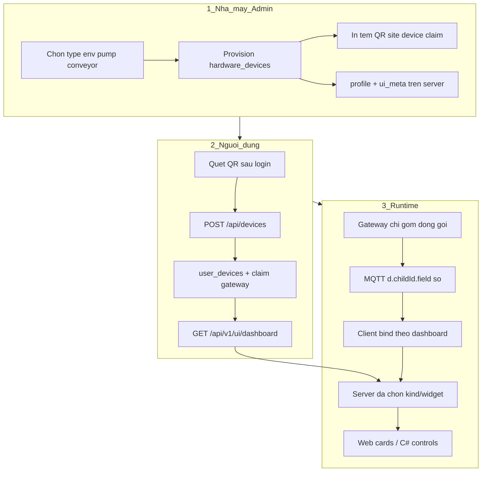

# UI Contract — dashboard widgets (webapp + C#)

Hợp đồng JSON để **webapp** và **C# SCADA** dựng cùng loại widget sau khi thêm thiết bị (QR).  
Client **không** hard-code theo tên máy; chỉ map `widget.kind` → control UI.

Song song với MQTT contract: `GET /api/v1/contract` ([PARTNER-INTEGRATION.md](PARTNER-INTEGRATION.md)).

## Phân công

- **Gateway:** gom + đóng gói số liệu (`d.<childId>.<field>`). Không phân loại, không vẽ.
- **Server:** phân loại (`type` / seed trên tem) → `GET /api/v1/ui/dashboard` trả widget đã resolve.
- **Client:** chỉ render `widgets[].kind` + bind số từ MQTT.

## Quy trình setup: data từ đâu → vẽ thế nào

Ba câu hỏi mọi hệ thống IoT phải trả lời (ThingsBoard / Home Assistant / Grafana / Ignition):

| Câu hỏi | ThingsBoard | Home Assistant | Grafana | **plciot** |
|---|---|---|---|---|
| Thiết bị là gì? | Device + Device Profile | Entity / integration | Data source + labels | `hardware_devices` + `user_devices` + `type` |
| Data thuộc device nào? | telemetry keys theo deviceId | `entity_id` | labels (`device=…`) | MQTT `d.<childId>.*` (hoặc `r[]` conveyor) |
| Vẽ UI thế nào? | Dashboard widgets bind key | Lovelace card theo entity | Panel query | `GET /api/v1/ui/dashboard` → `widgets[].kind` + `bind` |

### So sánh ngắn

- **ThingsBoard:** Admin tạo *Device Profile* (telemetries, alarms) → provision device → customer claim → dashboard kéo widget bind `temperature`.  
- **Home Assistant:** Integration phát hiện entity → card tự gợi ý theo `device_class` (temperature → gauge).  
- **Grafana:** Không “device”; panel = query + visualization type.  
- **plciot (V1):** Profile gắn **trên tem/server lúc in QR** (như Device Profile TB) → user chỉ quét → client lấy contract đã resolve (như card HA tự chọn), không editor Grafana.



### Các bước setup (làm đúng thứ tự)

**Bước 1 — Định nghĩa loại (catalog, 1 lần / sản phẩm)**  
Trong [`cloud/app/src/uiContract.js`](../cloud/app/src/uiContract.js): mỗi `type` có `keys` ý nghĩa + `widgets` mặc định (`kind`, `bind`, `unit`, `cmd`).  
≈ Device Profile (ThingsBoard) / device_class (HA).

**Bước 2 — Đăng ký phần cứng (admin / nhà máy)**  
`POST /api/admin/hardware` với `site`, `device`, `profile`, tuỳ chọn `uiMeta.seed[]`.  
In tem QR (chỉ identity ký: `site|device|claim`). **Type không cần nằm trong QR** — nằm DB.  
Script mẫu: `node cloud/app/scripts/gen-sample-device-qrs.js` → `tools/sample-qrs/`.

**Bước 3 — User thêm thiết bị**  
Đăng nhập → Tổng quan → **+ Thêm thiết bị** → dán/quét QR.  
Server: verify chữ ký → đọc `profile` → ghi `user_devices` → (nếu cần) claim gateway.  
**Không** hỏi chọn widget. Tem thiếu profile → `unknown_profile`.

**Bước 4 — Client biết vẽ gì**  
`GET /api/v1/ui/dashboard?mode=simple|pro` trả về:

- `devices[].childId` — id logic trong payload  
- `devices[].source.path` — vd `d.env1` hoặc `r`  
- `devices[].widgets[]` — `kind` + `bind` (+ `cmd` nếu ghi được)

Web và C# cùng document này.

**Bước 5 — Data đến gắn đúng device**  
Gateway publish (một message, nhiều device):

```json
{
  "schema": 2,
  "r": [ /* conveyor legacy */ ],
  "d": {
    "env1": { "t": 28.5, "h": 62 },
    "pump1": { "run": 1, "flow": 32 }
  }
}
```

| Trường | Ý nghĩa |
|---|---|
| Topic `plc/<site>/<gateway>/telemetry` | Thuộc **nhà máy / gateway** đã claim |
| Key trong `d` (`env1`, `pump1`) | **childId** = thiết bị con trên dashboard |
| Field `t`, `run`, … | Khớp `widget.bind` của type |

Client: với mỗi device, lấy object tại `source.path`, đọc `bind` → đổ vào gauge/kpi/toggle.

**Bước 6 — Mode giao diện**  
- `simple` (**mặc định điện thoại**): **widget cards** theo contract + tab **Báo cáo** (biểu đồ). Không sơ đồ SCADA, không Băng tải / I-O thủ công.  
- `pro`: SCADA kỹ thuật (I/O, legacy băng tải, đầy đủ panel). Cùng data + contract.

### Checklist khi thêm sản phẩm mới

1. Thêm `type` + widgets vào `DEVICE_TYPES`  
2. Firmware/gateway publish đúng `d.<childId>.<bind>`  
3. Admin provision `profile=<type>` (hoặc seed trong `ui_meta`)  
4. In tem → user quét → kiểm tra `GET /api/v1/ui/dashboard` có widgets  
5. Live MQTT → card đổi số  

### Endpoints

| Method | Path | Auth | Việc |
|---|---|---|---|
| GET | `/api/v1/ui/schema` | không | `widgetKinds`, `deviceTypes`, `modes` |
| GET | `/api/v1/ui/types` | không | Catalog type + default widgets |
| GET | `/api/v1/ui/types/:typeId` | không | Chi tiết 1 type |
| GET | `/api/v1/ui/dashboard?mode=simple\|pro` | Bearer | Dashboard đã resolve cho user |
| GET | `/api/devices` | Bearer | Instance thô |
| POST | `/api/devices` `{ qr }` | Bearer | Thêm từ QR — **tự lấy profile**, không hỏi type |
| DELETE | `/api/devices/:id` | Bearer | Gỡ khỏi dashboard |

## Sau quét QR

1. Verify chữ ký tem (`hardware_devices`).
2. Đọc `profile` + `ui_meta` trên server (đã provision).
3. Claim gateway nếu cần / thêm `user_devices`.
4. Trả `dashboard` hoặc client gọi lại `GET /api/v1/ui/dashboard`.

User **không** chọn kiểu widget. Tem thiếu profile → `unknown_profile`.

## Document `UiDashboardDocument`

Xem ví dụ trong plan / response thực tế. Trường chính:

- `devices[].type`, `childId`, `title`
- `devices[].source.path` — vd `d.env01` hoặc `r` (conveyor)
- `devices[].widgets[]` — `{ id, kind, bind, label, unit?, min?, max?, cmd? }`
- `layout.simple` / `layout.pro`

### `kind` ổn định

`kpi` | `gauge` | `ring` | `sparkline` | `line` | `bar` | `table` | `chip` | `toggle` | `button` | `status` | `text`

Kind lạ → fallback `kpi` / `text`.

## MQTT telemetry

Tương thích `schema:1` `{ r: [...] }`. Mở rộng:

```json
{
  "schema": 2,
  "r": [0, 0, ...],
  "d": {
    "env01": { "t": 28.5, "h": 62 },
    "pump1": { "run": 1, "hours": 12.4, "flow": 32 }
  }
}
```

`d` = map thiết bị con; một message có thể chứa nhiều loại.

## C#

Models: `Plciot.Scada.Services.Ui` (`UiDashboardDocument`, …).  
`GET /api/v1/ui/dashboard` sau khi có JWT/cloud session — factory `kind` → UserControl.

## QR mẫu

```bash
cd cloud/app
node scripts/gen-sample-device-qrs.js
# → tools/sample-qrs/*.txt
```

Smoke: `node scripts/smoke-ui-contract.js`
